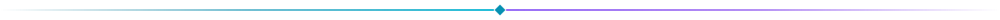

<a id="top"></a>

<div align="center">


[](VERSION)
[](https://github.com/remnawave/backend)
[](LICENSE)

<sub>Быстрый переход</sub>

[](#install)
[](#bot)
[](#import)
[](#commands)

[](#what)
[](#features)
[](#security)
[](#files)

</div>

<picture><source media="(prefers-color-scheme: dark)" srcset="assets/divider-dark.svg"></picture>

<a id="what"></a>

## 📋 Что это

Бэкап **только базы** Remnawave — без nginx и файлов. Живёт на том же сервере, что панель.

| Файл | Роль |
|---|---|
| [`install.sh`](install.sh) | установка, меню, служба, обновление, удаление |
| [`rw-back-bot.sh`](rw-back-bot.sh) | бот: экспорт/импорт, настройки, автобэкап |

<div align="center"></div>

<picture><source media="(prefers-color-scheme: dark)" srcset="assets/divider-dark.svg"></picture>

<a id="features"></a>

## ✨ Возможности

- 💾 дамп `pg_dumpall` в `.sql.gz`, отправка в Telegram
- ⏰ автобэкап каждые 3/6/12/24 ч или своё
- 📦 хранение 2/5/10 архивов или своё число
- 📥 импорт из `.sql`, `.sql.gz`, `.zip` с проверкой файла
- 🛡 страховочный дамп, пауза панели, автооткат при сбое
- ⬆️ проверка новой версии через GitHub

<picture><source media="(prefers-color-scheme: dark)" srcset="assets/divider-dark.svg"></picture>

<a id="install"></a>

## 🚀 Установка

```bash
ssh root@your-server-ip
curl -sSL https://raw.githubusercontent.com/CyberERROR/rw-back/main/install.sh | bash
```

Установщик спросит токен бота и покажет **код привязки**:

```text
🔑 КОД ПРИВЯЗКИ АДМИНА:  847213
1. https://t.me/your_bot
2. /start
3. 847213
```

Отправьте код боту **в личку** — он запишет ваш Telegram ID главным админом.
Код живёт 30 минут, 10 попыток. Новый: `rw-back admin-code`.

<picture><source media="(prefers-color-scheme: dark)" srcset="assets/divider-dark.svg"></picture>

<a id="bot"></a>

## 🤖 Бот

`/start` → два раздела:

| Раздел | Что внутри |
|---|---|
| 💎 **Remnawave** | 📤 Экспорт · 📥 Импорт · 📦 Бэкапы на сервере |
| ⚙️ **Настройки** | 👥 Админы · 🕒 Расписание · 📦 Хранить файлов |

Админы добавляются по `ID` или `@username`; последнего удалить нельзя.
Экспорт и импорт доступны только админам, дампы — только в личку.

<picture><source media="(prefers-color-scheme: dark)" srcset="assets/divider-dark.svg"></picture>

<a id="import"></a>

## 📥 Импорт

1. Проверка файла: заголовок pg_dump, таблицы Remnawave, опасные команды
2. Страховочный дамп текущей БД
3. Пауза панели → восстановление → сброс кэша valkey
4. Запуск панели и ожидание `healthy`
5. Не поднялась — откат страховочным дампом

Лимиты Telegram: **20 МБ** на скачивание, **50 МБ** на отправку. Если файл больше — бот пришлёт пошаговую инструкцию (`scp` → `rw-back validate` → `rw-back restore`).

<picture><source media="(prefers-color-scheme: dark)" srcset="assets/divider-dark.svg"></picture>

<a id="commands"></a>

## ⌨️ Команды

| Команда | Что делает |
|---|---|
| `rw-back` | меню |
| `rw-back backup` | бэкап + отправка админам |
| `rw-back restore ФАЙЛ` | восстановить БД |
| `rw-back validate ФАЙЛ` | проверить дамп |
| `rw-back list` | список архивов |
| `rw-back update` | обновить |
| `rw-back admin-code` | новый код привязки |
| `rw-back remove` | удалить |

<picture><source media="(prefers-color-scheme: dark)" srcset="assets/divider-dark.svg"></picture>

<a id="security"></a>

## 🛡 Безопасность

- `config.env` — `600`, каталоги — `700`
- только админы, чужие сообщения игнорируются
- первый админ — одноразовый код (30 минут, личка, 10 попыток)
- параллельные операции блокируются (`flock`)
- дампы не публикуются в группы

<picture><source media="(prefers-color-scheme: dark)" srcset="assets/divider-dark.svg"></picture>

<a id="files"></a>

## 🗂 Файлы

```text
/opt/rw-back/
├── install.sh · rw-back-bot.sh · VERSION
├── config.env          настройки (600)
├── backup/             архивы, pre_restore/
├── state/              код привязки, входящие файлы
└── logs/
```

<picture><source media="(prefers-color-scheme: dark)" srcset="assets/divider-dark.svg"></picture>

## 📄 Лицензия

[GPLv3](LICENSE)

<div align="center">

[](https://github.com/CyberERROR/rw-back/issues/new)
[](https://github.com/CyberERROR/rw-back)

<a href="#top">⬆️ Наверх</a>


</div>
