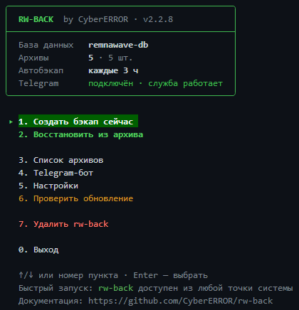
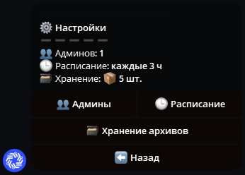
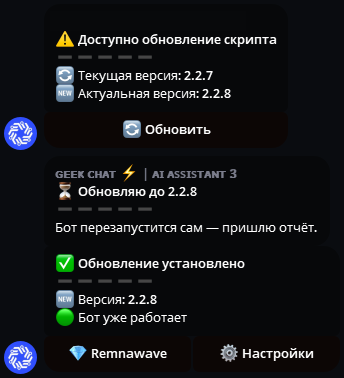

<div align="center">


<a href="https://github.com/CyberERROR/rw-back">
  
</a>

<p>
  
</p>

[](VERSION)
[](https://github.com/remnawave/backend)
[](https://github.com/CyberERROR/rw-back/stargazers)
[](https://t.me/+YV_BO1cmGWw5OTdi)

[](#install)
[](#install)
[](LICENSE)
[](https://github.com/CyberERROR/rw-back/commits)
[](https://github.com/CyberERROR/rw-back/issues)

<br>

<table>
<tr>
<td align="center"><a href="#about"><b>📋<br>Что это</b></a></td>
<td align="center"><a href="#features"><b>✨<br>Возможности</b></a></td>
<td align="center"><a href="#install"><b>🚀<br>Установка</b></a></td>
<td align="center"><a href="#bot"><b>🤖<br>Бот</b></a></td>
<td align="center"><a href="#import"><b>📥<br>Импорт</b></a></td>
<td align="center"><a href="#commands"><b>⌨️<br>Команды</b></a></td>
<td align="center"><a href="#security"><b>🛡️<br>Безопасность</b></a></td>
<td align="center"><a href="#files"><b>🗂️<br>Файлы</b></a></td>
</tr>
</table>

</div>

<a id="about"></a>


**rw-back** — резервное копирование **только базы данных** Remnawave: без nginx, без файлов, без мусора.
Живёт на том же сервере, что и панель, работает с её Docker-контейнером БД.

<div align="center">

 ➜
 ➜
 ➜


<sub>💾 <b>Дамп</b> уходит в Telegram · 📥 <b>Импорт</b> возвращает базу на место</sub>

</div>

| Файл | Роль |
|:--|:--|
| [`install.sh`](install.sh) | установка, меню, служба, обновление, удаление |
| [`rw-back-bot.sh`](rw-back-bot.sh) | бот: экспорт/импорт, настройки, автобэкап |

<div align="center">

**📸 Как это выглядит**



<sub>🖥 Меню в консоли</sub>

</div>

<details>
<summary><b>📱 Скриншоты бота — 5 шт.</b></summary>

<br>

| <br><sub><b>01</b> · 🤖 Главный экран</sub> | <br><sub><b>02</b> · 💾 Бэкап в чате</sub> |
|:--:|:--:|
| <br><sub><b>03</b> · 📤 Экспорт и импорт</sub> | <br><sub><b>04</b> · ⚙️ Настройки</sub> |

<div align="center">


<br>
<sub><b>05</b> · 🔄 Обновление из чата</sub>

</div>

</details>

<a id="features"></a>


<table>
<tr>
<td width="50%" valign="top">

**💾 Бэкап**
- ✅ дамп `pg_dumpall` в `.sql.gz`
- ✅ отправка админам в Telegram с датой, размером и метриками сервера
- ✅ файл уходит сразу, метрики дозаполняются после отправки
- ✅ автобэкап каждые 3/6/12/24 ч или своё
- ✅ напоминание об обновлении с кнопкой «Обновить» прямо в чате
- ✅ команда `/update` — проверка версии в любой момент
- ✅ хранение на выбор: по числу файлов (2/5/10 или своё) **или** по сроку в днях

</td>
<td width="50%" valign="top">

**📥 Импорт**
- ✅ `.sql`, `.sql.gz`, `.zip`
- ✅ проверка файла и таблиц Remnawave
- ✅ страховочный дамп перед восстановлением
- ✅ автооткат, если панель не поднялась

</td>
</tr>
</table>

<a id="install"></a>


> [!NOTE]
> **Что нужно заранее:** 🐧 Ubuntu 20.04+ / Debian 11+ · 🔑 SSH с правами `root` · 📦 Remnawave на этом же сервере · 💾 от 1 GB RAM


```bash
ssh root@your-server-ip
```


```bash
curl -sSL https://raw.githubusercontent.com/CyberERROR/rw-back/main/install.sh | bash
```

> [!TIP]
> **Telegram необязателен.** Поле токена можно оставить пустым: локальные бэкап, восстановление и список архивов будут работать сразу. Бот настраивается позже через `rw-back` → **Telegram-бот** или **Настройки → Telegram** — без переустановки.


Если вы указали токен, установщик проверит его, запустит службу и покажет **код привязки**:

```text
🔑 КОД ПРИВЯЗКИ АДМИНА:  847213
1. https://t.me/your_bot
2. /start
3. 847213
```

Отправьте код боту **в личку** — он запишет ваш Telegram ID главным админом.
Код живёт 30 минут, 10 попыток. Новый: `rw-back admin-code`.

> [!CAUTION]
> Пока главный админ не привязан, бот не выполняет никаких операций — только ждёт код.

<a id="bot"></a>


`/start` → два раздела:

| Раздел | Что внутри |
|:--|:--|
| 💎 **Remnawave** | 📤 Экспорт · 📥 Импорт · 📦 Бэкапы на сервере |
| ⚙️ **Настройки** | 👥 Админы · 🕒 Расписание · 🗃 Хранение архивов |

Админы добавляются по `ID` или `@username`; последнего удалить нельзя.
Экспорт и импорт доступны только админам, дампы — только в личку.

<a id="import"></a>


| | Шаг | Что происходит |
|:--:|:--|:--|
| **1** | 🔍 **Проверка файла** | заголовок pg_dump · таблицы Remnawave · опасные команды · zip-slip |
| **2** | 💾 **Страховка** | дамп текущей БД сохраняется в `backup/pre_restore/` |
| **3** | ⏸️ **Пауза панели** | восстановление базы и сброс кэша valkey |
| **4** | ▶️ **Запуск** | панель поднимается, ждём `healthy` до 180 секунд |
| **5** | ↩️ **Откат** | не поднялась — база возвращается страховочным дампом |

> [!WARNING]
> Лимиты Telegram: **20 МБ** на скачивание и **50 МБ** на отправку. Если файл больше — бот пришлёт пошаговую инструкцию: `scp` → `rw-back validate` → `rw-back restore`.

<a id="commands"></a>


| Команда | Что делает |
|:--|:--|
| `rw-back` | меню |
| `rw-back backup` | бэкап + отправка админам, если Telegram настроен |
| `rw-back restore ФАЙЛ` | восстановить БД |
| `rw-back validate ФАЙЛ` | проверить дамп |
| `rw-back list` | список архивов |
| `rw-back update` | обновить |
| `rw-back admin-code` | новый код привязки |
| `rw-back remove` | удалить |

<a id="security"></a>


- 🔐 `config.env` — `600`, каталоги — `700`
- 👤 только админы, чужие сообщения игнорируются
- 🔑 первый админ — одноразовый код (30 минут, личка, 10 попыток)
- 🔒 параллельные операции блокируются (`flock`)
- 📵 дампы не публикуются в группы

<a id="files"></a>


```text
/opt/rw-back/
├── install.sh · rw-back-bot.sh · VERSION
├── config.env          настройки (600)
├── backup/             архивы, pre_restore/
├── state/              код привязки, входящие файлы
└── logs/
```


Сначала загляните в [Issues](https://github.com/CyberERROR/rw-back/issues) — возможно, это уже известно.
Если нет — [создайте новый](https://github.com/CyberERROR/rw-back/issues/new) и укажите: **📝 что произошло · 🔁 как воспроизвести · 💻 ОС и версию**.

## 📄 Лицензия

Распространяется по лицензии **[GPLv3](LICENSE)** — можно свободно использовать, изучать, модифицировать и распространять код при соблюдении условий лицензии.

<div align="center">

<br>

[](https://t.me/+YV_BO1cmGWw5OTdi)
[](https://github.com/CyberERROR/rw-back)

**Сделано с ❤️ для сообщества** · <a href="#about">⬆️ Наверх</a>


</div>
