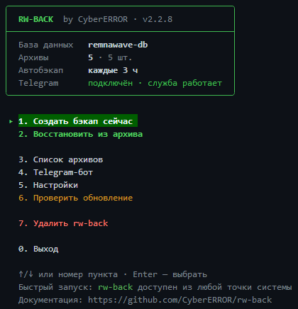
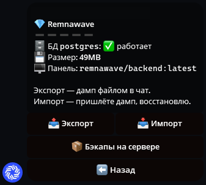
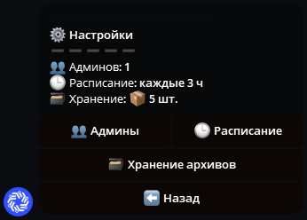

<div align="center">

# 💎 RW-BACK

**Резервное копирование базы Remnawave — одной кнопкой, с доставкой в Telegram**

[](../VERSION)
[](https://github.com/remnawave/backend)
[](../install.sh)
[](../LICENSE)

🐳 **Remnawave** ➜ `pg_dumpall` ➜ 📤 **Telegram** ➜ 📥 **Восстановление**

</div>

## 📸 Скриншоты

<div align="center">

**🖥 Меню в консоли**



</div>

<details>
<summary><b>📱 Скриншоты бота — 4 шт.</b></summary>

<br>

| <br><sub><b>01</b> · 🤖 Главный экран</sub> | <br><sub><b>02</b> · 💾 Бэкап в чате</sub> |
|:--:|:--:|
| <br><sub><b>03</b> · 📤 Экспорт и импорт</sub> | <br><sub><b>04</b> · ⚙️ Настройки</sub> |

</details>

## ✨ Что нового в 2.2.9

- 🔔 автобэкап больше не молчит: при сбое приходит сообщение с причиной
- 🩺 точные причины вместо «pg_dumpall вернул ошибку»: нет контейнера БД · пустой дамп · обрыв соединения · файл не доставлен
- 📅 статус в боте: последний бэкап, следующий запуск, последняя ошибка
- 🔁 неудачная попытка тоже фиксируется — каскада запусков каждые 5 минут нет
- ✋ `rw-back cron --force` — прогон вручную, расписание не сдвигается
- ⏱ запас 5 минут: тик, пришедший на секунду раньше, больше не съедает час
- 🖥 в консольном меню видно «след. 10:00» или «⚠ сбой · причина»

## 🚀 Установка

```bash
curl -sSL https://raw.githubusercontent.com/CyberERROR/rw-back/main/install.sh | bash
```

## 🔄 Обновление

```bash
sudo rw-back update
```

## 📄 Лицензия

Распространяется по лицензии **[GPLv3](../LICENSE)**.

<div align="center">

**CyberERROR** · [github.com/CyberERROR/rw-back](https://github.com/CyberERROR/rw-back)

</div>
