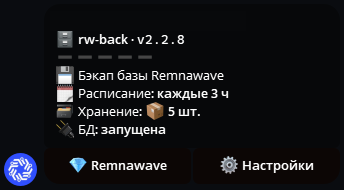
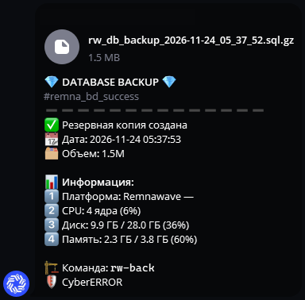

<div align="center">

# 💎 RW-BACK

**Резервное копирование базы Remnawave — одной кнопкой, с доставкой в Telegram**

[](../VERSION)
[](https://github.com/remnawave/backend)
[](../install.sh)
[](../LICENSE)

🐳 **Remnawave** ➜ `pg_dumpall` ➜ 📤 **Telegram** ➜ 📥 **Восстановление**

</div>

## 📸 Скриншоты

<div align="center">

**🖥 Меню в консоли**


</div>

<details>
<summary><b>📱 Скриншоты бота — 4 шт.</b></summary>

<br>

| <br><sub><b>01</b> · 🤖 Главный экран</sub> | <br><sub><b>02</b> · 💾 Бэкап в чате</sub> |
|:--:|:--:|
| <br><sub><b>03</b> · 📤 Экспорт и импорт</sub> | <br><sub><b>04</b> · ⚙️ Настройки</sub> |

</details>

## ✨ Что нового в 2.2.10

- 🔧 уходит от «битого архива»: дамп пишется целиком, проверяется финальная метка `pg_dumpall`, и только потом сжимается
- 🔁 повтор дампа через 15 секунд — разовый сбой записи больше не съедает бэкап
- ⏱ тик перенесён на `:17` — вне пика задач, стартующих в начале часа
- 🗄 битый дамп не удаляется, а уходит в карантин `state/corrupt/` — можно вскрыть и увидеть место обрыва
- 💾 проверка свободного места перед дампом и в сообщении о сбое
- ❌ причины стали точнее: код возврата и текст ошибки `pg_dumpall`, обрыв дампа, мало места

## 🚀 Установка

```bash
curl -sSL https://raw.githubusercontent.com/CyberERROR/rw-back/main/install.sh | bash
```

## 🔄 Обновление

```bash
sudo rw-back update
```

## 📄 Лицензия

Распространяется по лицензии **[GPLv3](../LICENSE)**.

<div align="center">

**CyberERROR** · [github.com/CyberERROR/rw-back](https://github.com/CyberERROR/rw-back)

</div>
